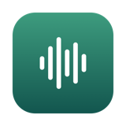
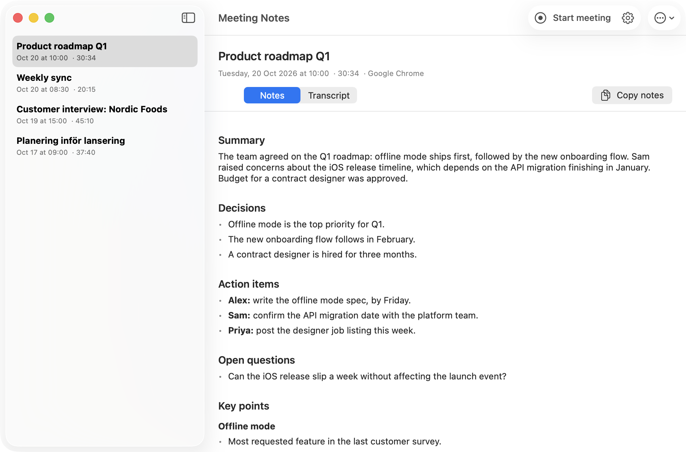
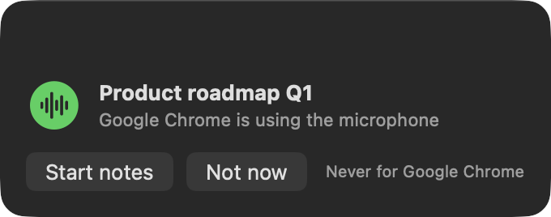

# Meeting Notes

**Mac · Windows · Android · iPhone** · **[meetingnotes.frinkle.se](https://meetingnotes.frinkle.se)**

Private meeting notes without a bot in the call. Meeting Notes records your meetings, transcribes them **on your own
device** with [whisper.cpp](https://github.com/ggml-org/whisper.cpp), and writes structured notes: summary, decisions,
action items, open questions and key points.

- **Mac and Windows, for video calls.** Records your microphone and the call audio as two tracks, transcribes them on
  your computer, and writes the notes with [Claude Code](https://claude.com/claude-code),
  [Codex (OpenAI)](https://developers.openai.com/codex/cli/) or a local model with [Ollama](https://ollama.com).
- **Android and iPhone, for in-person meetings.** Records with the phone's microphone and makes the transcript and the
  notes on the phone, offline, with Whisper and Google's Gemma 3 running in [llama.cpp](https://github.com/ggml-org/llama.cpp).
- **Ask Claude about your meetings.** A read-only [MCP](https://modelcontextprotocol.io) server lets Claude Desktop,
  Claude Code and other AI apps search your notes and transcripts (Mac and Windows).

Open source (MIT). The ready-made apps for Mac, Windows and Android are sold at
**[meetingnotes.frinkle.se](https://meetingnotes.frinkle.se)** (a one-time purchase, no subscription), or build them
yourself for free.

## On the Mac

- **Two tracks, no virtual audio driver.** Your microphone and the call audio are captured separately with
  a Core Audio tap, so the transcript knows who said what (your name vs "Others").
- **Detects calls automatically.** When an app such as Google Meet (in any browser), Zoom, Teams or FaceTime starts
  using the microphone, a small prompt offers to take notes, and recording stops a few seconds after you leave the call.
- **Names meetings for you.** In browsers it reads the call tab's title (e.g. "Meet – Weekly sync" becomes "Weekly sync").
- **Private by default.** Audio never leaves your Mac and is deleted as soon as the transcript is ready. Only the text
  transcript is sent to your selected provider to write the notes. With the local model (Ollama) nothing leaves your Mac at all.
- **Runs in the background.** It starts at login without a window, lives in the menu bar, and sends a notification
  when the notes for a meeting are ready.
- **Swedish, Danish and English** (or automatic language detection). Notes are written in the meeting's language.

<p align="center">
  <picture>
    <source media="(prefers-color-scheme: dark)" srcset="docs/images/window-dark.png">
    
  </picture>
</p>
<p align="center">
  
</p>

Each meeting gets its own folder with `transcript.md`, `notes.md` (Summary, Decisions, Action items, Open questions,
Key points) and `meta.json`. The audio is deleted as soon as the transcript is ready, unless you turn on
**Keep audio recordings** in Settings (then it's kept as 16 kHz WAV, which lets you redo the transcript).

The [Windows app](windows/README.md) does the same and writes the same meeting folders. The [Android app](android/README.md)
and the [iPhone app](ios/README.md) use the same folder layout, on the phone.

## Download and install

| Platform | Download | Requirements |
|---|---|---|
| Mac | [MeetingNotes.dmg](https://github.com/horken7/MeetingNotes/releases/latest/download/MeetingNotes.dmg) | macOS 15 (Sequoia) or newer, Apple silicon or Intel |
| Windows | [MeetingNotes-Setup.exe](https://github.com/horken7/MeetingNotes/releases/latest/download/MeetingNotes-Setup.exe) | Windows 10 (1809) or 11, x64 (Windows on Arm runs it emulated) |
| Android | [MeetingNotes.apk](https://github.com/horken7/MeetingNotes/releases/latest/download/MeetingNotes.apk) | Android 10 or newer, 64-bit Arm (most phones from 2019 on), 4 GB of memory |
| iPhone | Build from source with Xcode ([below](#iphone)); not on the App Store yet | iOS 26 or newer |

The files are on the [latest GitHub Release](https://github.com/horken7/MeetingNotes/releases/latest). The speech models
are inside each download (the DMG and the Windows installer are about 1.7 GB, the APK about 1.4 GB), so nothing more is
downloaded for transcription at first run.

**Buy:** the ready-made apps, with updates and setup help by email, are sold at
[meetingnotes.frinkle.se](https://meetingnotes.frinkle.se) by Frinkle AB (Sweden): €29 per platform, or Mac, Windows and
Android together for €59, VAT included, paid once through Stripe. Buying also funds development.

### Mac

1. Download [MeetingNotes.dmg](https://github.com/horken7/MeetingNotes/releases/latest/download/MeetingNotes.dmg), open
   it and drag **Meeting Notes** to **Applications**.
2. Open it. The app is signed ad hoc and **not notarized** by Apple, so the first time macOS says it can't verify the
   app. Click **Done** (not Move to Trash), open **System Settings > Privacy & Security**, scroll down to the message
   about Meeting Notes, click **Open Anyway** and confirm. (On macOS 14 and older, right-clicking the app and choosing
   **Open** did the same; macOS 15 removed that shortcut.) You only need to do this once per version.
3. A setup window installs and signs in to the notes provider you choose (Claude, Codex or the local model) and asks for
   the permissions. whisper-cli, the Whisper large-v3-turbo model, the voice activity model and the MCP server are
   inside the app.

A Claude account (for Claude Code) or a Codex login (ChatGPT or API authentication) is needed to write the notes,
unless you use the local model, which needs no account but about 8 GB of disk and 16 GB of memory.

### Windows

Run [MeetingNotes-Setup.exe](https://github.com/horken7/MeetingNotes/releases/latest/download/MeetingNotes-Setup.exe). It
installs for your user only (no administrator rights) to `%LOCALAPPDATA%\Programs\MeetingNotes`. The installer isn't
signed yet, so the first time Windows SmartScreen says "Windows protected your PC": click **More info**, then
**Run anyway**. On first launch a setup assistant helps install and sign in to the notes provider. See
[windows/README.md](windows/README.md).

### Android

On the phone, open the [latest release](https://github.com/horken7/MeetingNotes/releases/latest) in the browser and tap
**MeetingNotes.apk** (1.4 GB, so use Wi-Fi). Open the downloaded file; Android asks whether to let the browser (or Files)
**install unknown apps**: tap **Settings**, turn on **Allow from this source**, go back and tap **Install**. If Google Play
Protect warns that it doesn't know the app, choose **Install anyway**. Updates install the same way and keep your
meetings. Step by step: [android/README.md](android/README.md#install).

### iPhone

The iPhone app isn't on the App Store yet. Build it from source with Xcode 26 and install it on your own iPhone with a
free Apple ID (iOS then lets it run for 7 days at a time; press Run in Xcode again after that, your meetings are kept).
Step by step: [ios/README.md](ios/README.md#install-on-your-iphone-for-free).

## Models

Everything runs on your device. The models come from public Hugging Face repositories and are checked by SHA-256.

| | Speech recognition (whisper.cpp) | Notes |
|---|---|---|
| Mac | Whisper large-v3-turbo and Silero voice detection, built in | Claude Code (`claude -p`), Codex (`codex exec`) or Ollama (default `gemma3:12b`, downloaded with Ollama) |
| Windows | Whisper large-v3-turbo and Silero voice detection, built in | Claude Code, Codex or Ollama, as on the Mac |
| Android | Whisper large-v3-turbo (q5_0) and Silero, built in. Optional downloads: [KB-Whisper](https://huggingface.co/KBLab/kb-whisper-small) small for Swedish, Whisper small (faster) for other languages | Gemma 3 1B in llama.cpp, built in. Optional download: Gemma 3 4B |
| iPhone | Whisper small and Silero, built in. Optional downloads: [KB-Whisper](https://huggingface.co/KBLab/kb-whisper-medium) medium or large for Swedish, Whisper large-v3-turbo for English and Danish | Gemma 3 1B in llama.cpp, built in. Optional: Gemma 3 4B, or Apple Intelligence on iPhones that have it |

KB-Whisper, from the National Library of Sweden (KBLab), makes far fewer mistakes in Swedish than OpenAI's Whisper
models. Gemma is provided under the [Gemma Terms of Use](https://ai.google.dev/gemma/terms).

## Privacy

- Audio is recorded and kept only on your device, and is **deleted as soon as the transcript is ready**, unless you
  turn on **Keep audio recordings** in Settings (needed to redo a transcript).
- Transcription always runs on the device.
- On Mac and Windows, with Claude or Codex only the text transcript is sent to Anthropic or OpenAI, through your own
  account, to write the notes. With the local model (Ollama) nothing leaves the computer.
- On the phones the notes are written on the phone, and the network is only used to download optional models. On
  Android, **Share…** sends a transcript to the Claude app (or another app) only when you choose to.
- The apps have no accounts, analytics or telemetry. The MCP server is read-only and runs only when an AI app starts it.

## Build from source

### Mac

Needs macOS 15, the Xcode command line tools (`xcode-select --install`), [Homebrew](https://brew.sh) and about 2 GB of
disk for the speech model.

```bash
git clone https://github.com/horken7/MeetingNotes.git
cd MeetingNotes
bash install.sh                       # Claude by default
# or: bash install.sh --provider codex
# or: bash install.sh --provider ollama   # fully local notes
```

The installer:

1. installs `whisper-cpp` with Homebrew and the selected notes CLI if needed,
2. downloads the Whisper `large-v3-turbo` model (about 1.6 GB) and the Silero voice activity model to `~/.meetnotes/`,
3. compiles the app with `swiftc`, signs it ad hoc and installs it to `/Applications/Meeting Notes.app`,
4. builds the MCP server to `~/.meetnotes/bin/meetingnotes-mcp`,
5. opens the app.

### Windows

Needs the .NET 8 SDK on Windows (the Core library and its tests also run on macOS and Linux):

```powershell
powershell -ExecutionPolicy Bypass -File windows\build.ps1   # tests, bundles whisper.cpp and the models, makes windows\artifacts\MeetingNotes-Setup.exe
```

More in [windows/README.md](windows/README.md#development).

### Android

Needs JDK 17 and the Android SDK (Gradle installs NDK 27.1 and CMake 3.22.1 if missing):

```bash
cd android
./gradlew :app:universalApk   # app/build/outputs/universal/MeetingNotes.apk (downloads the 1.4 GB of models the first time)
```

More in [android/README.md](android/README.md#for-developers).

### iPhone

Needs a Mac with Xcode 26 and its iOS 26 platform, and CMake (`brew install cmake`):

```bash
bash ios/scripts/build-native.sh   # whisper.cpp and llama.cpp as an xcframework
bash ios/scripts/fetch-models.sh   # the built-in models (about 1 GB)
open ios/MeetingNotes.xcodeproj    # pick your team under Signing & Capabilities, then Run on your iPhone
```

More in [ios/README.md](ios/README.md).

## Setting up the Mac app

On first launch, allow **Microphone**. When the first recording starts, allow **System Audio Recording** (that is how
the app hears the other people on the call; it never records the screen, so Screen Recording isn't needed). The first time a meeting is
detected in a browser, macOS also asks to let Meeting Notes read the browser's tabs, which is used only for the
meeting name.

With the DMG, the setup window installs the notes CLI and signs you in (Settings > Set up Meeting Notes… opens it
again). When built from source, log in once in Terminal: `claude` for Claude Code or `codex login` for Codex.
Choose **Settings > Notes > Write notes with** to switch providers, including when regenerating notes.
Install the other CLI before switching (or rerun `bash install.sh --provider claude|codex|ollama` with one provider).
For a custom or npm installation, set the executable's absolute path in Settings. Reinstalling without
`--provider` preserves your selected provider.

### Local notes with Ollama

Choose **Local model (Ollama)** to write the notes on your Mac: the transcript is sent only to Ollama's server at
`http://localhost:11434`, so nothing leaves the Mac. `bash install.sh --provider ollama` (or `--provider local`) installs
Ollama with Homebrew, starts it and pulls the default model. To set it up by hand:

```bash
brew install ollama
brew services start ollama
ollama pull gemma3:12b
```

Settings > Notes has the model name and the Ollama address; Settings > Setup shows whether Ollama is running and the
model is downloaded, and how to fix it if not.

The default model is `gemma3:12b` (an 8 GB download, about 8 GB of memory while it runs, so a Mac with 16 GB or more).
Of the models tried it wrote the best Swedish and Danish notes; `qwen3:8b` (5 GB) often answered in English. Local
models tend to reply in the language of the instructions, so the app recognizes the transcript's language on the Mac
and, with the default instructions, asks for notes in that language. The context window is sized to the transcript, up
to 32k tokens: about 70 minutes of conversation. Longer transcripts are cut at the end, and the notes then say up to
which time they cover. On an M-series Mac, notes for a short meeting take 10 to 20 seconds and for an hour about 2 to 3
minutes. Any other model from `ollama list` works too, for example `gemma3:4b` for Macs with 8 GB.

> Each build is signed ad hoc, so macOS asks for the permissions again after every reinstall, and it refuses
> notification permission. To fix both, sign with a certificate (below).

### Signing with a certificate (optional)

Pass a code-signing identity from your keychain and the installer signs with it instead of ad hoc. The signature
then stays the same across reinstalls, so Microphone and System Audio Recording permissions are kept, and macOS can
allow real notifications (the "Meeting detected" notification with buttons, clickable "Notes ready" alerts).

```bash
security find-identity -p codesigning          # list the identities you have
SIGN_IDENTITY="Apple Development: Your Name (TEAMID)" bash install.sh
```

Ways to get an identity:

- **Free Apple Development certificate** (recommended): sign in with your Apple ID in Xcode > Settings > Accounts,
  then Manage Certificates > + > Apple Development. It is valid for a year; renew it the same way when
  `find-identity` shows `CSSMERR_TP_CERT_EXPIRED`.
- **Self-signed certificate**: Keychain Access > Certificate Assistant > Create a Certificate…, Identity Type
  Self Signed Root, Certificate Type Code Signing, then use its name as `SIGN_IDENTITY`. This keeps permissions
  across reinstalls; whether macOS grants notification permission for it is less certain than with an Apple
  certificate.

After the first signed install, allow the permissions once more (the signature changed from ad hoc), and allow
notifications when asked or under System Settings > Notifications > Meeting Notes.

## Use

- Join a call. A "Meeting detected" prompt appears after a few seconds: **Start notes**, **Not now**, or
  **Never for this app**. You can also press **Start meeting** in the window or the menu bar.
  The prompt is a notification when notifications are allowed (click it or choose Start notes from its Options
  menu; set the app to **Alerts** in System Settings > Notifications to keep it on screen), and otherwise a small
  floating panel. Settings > Automatic > Ask with chooses between them.
- The menu bar icon shows the state: waveform (idle), red dot (recording), hourglass (transcribing / writing notes).
- When the notes are ready you get a notification; click it to open the meeting. macOS refuses notification
  permission for ad hoc signed apps, so in that case the alert is sent through Script Editor instead (allow Script
  Editor under System Settings > Notifications) and calls are offered with the floating panel; see
  [Signing with a certificate](#signing-with-a-certificate-optional). Settings > Setup shows the status and has a **Send test** button.
- Closing the window keeps the app running in the menu bar (no Dock icon). Open it again from the menu bar or
  by opening the app. It starts at login by default; turn that off in Settings.
- Leave the call and recording stops on its own about 5 seconds later. Transcription takes roughly a minute per
  10 minutes of call, then your selected provider writes the notes.
- In the window you can rename meetings, copy notes or the transcript, regenerate notes, redo the transcript,
  show the folder in Finder, or move a meeting to the Trash (right-click or ⌘⌫).

To change how the notes look (sections, length, style, language), edit **Settings > Notes > How the notes should
look**. Your name, who is who and the meeting title are always added; **Reset to default** restores the standard
format, and **Regenerate notes** applies a new format to an existing meeting.

Meetings are saved in `~/Documents/Meetings` by default. Change the folder, your name, language,
automatic start/stop, open at login and whether audio is kept in **Settings**.

## Ask Claude and other AI apps about your meetings (MCP)

The Mac app comes with a small, read-only [MCP](https://modelcontextprotocol.io) server, so Claude Desktop, Claude Code
and other MCP clients can look up your meetings. In the DMG app it is
`/Applications/Meeting Notes.app/Contents/MacOS/meetingnotes-mcp`; `install.sh` builds it to
`~/.meetnotes/bin/meetingnotes-mcp`. The Windows app has the same server (`meetingnotes-mcp.exe`) and the same buttons,
see [windows/README.md](windows/README.md).
It reads `meta.json`, `notes.md` and `transcript.md` in your meetings folder (the one set in Settings), never
audio files, and can't change or delete anything. It runs only when a client starts it, on your Mac.

**Claude Desktop:** in Meeting Notes, open **Settings > Setup** and press **Add to Claude Desktop** (or double-click
`MeetingNotes.mcpb`: in the app's `Contents/Resources`, or in `~/.meetnotes/` when built from source). Claude Desktop
shows the extension; press **Install**. It runs the server of the installed app, so later updates need no reinstall of
the extension.

**Other apps:** the **Other apps** menu next to it copies the command or config for each of these, with the right path
for your installation. Built from source they are (replace `YOU` with your user name; for the DMG app use the path above):

| App | How to add it |
|---|---|
| Claude Code | `claude mcp add --scope user meeting-notes -- ~/.meetnotes/bin/meetingnotes-mcp` |
| Codex | `codex mcp add meeting-notes -- ~/.meetnotes/bin/meetingnotes-mcp` |
| VS Code (Copilot) | `code --add-mcp '{"name":"meeting-notes","command":"/Users/YOU/.meetnotes/bin/meetingnotes-mcp"}'` |
| Cursor, LM Studio, Windsurf, Gemini CLI and most others | add the JSON below to their MCP config (`~/.cursor/mcp.json`, LM Studio's `mcp.json`, `~/.gemini/settings.json`, …) |

```json
{
  "mcpServers": {
    "meeting-notes": {
      "command": "/Users/YOU/.meetnotes/bin/meetingnotes-mcp"
    }
  }
}
```

ChatGPT's apps only connect to remote (internet) MCP servers, so they can't use this local one.

Then ask things like "What did we decide in last week's sync?" or "Find meetings where we talked about the budget".

| Tool | What it does |
|---|---|
| `list_meetings` | Meetings, newest first: id, title, date, duration, status, call app. Optional `from` / `to` (YYYY-MM-DD) and `limit` |
| `search_meetings` | Case-insensitive search across titles, notes and transcripts, with snippets |
| `get_notes` | The notes of a meeting (by id) |
| `get_transcript` | The transcript of a meeting (by id); long ones are returned in 100,000-character parts |

Notes and transcripts of the 100 newest meetings are also listed as MCP resources. Set `MEETINGNOTES_DIR` in the
server's environment to read another folder. Notes and transcripts you look up are sent to the MCP client's model
like any other text you share with it.

## How it works

| File | What it does |
|---|---|
| `src/App.swift` | App entry point, main window and menu bar item |
| `src/Model.swift` | Settings, meeting storage, start/stop, call detection and auto-stop |
| `src/Recorder.swift` | Mic (AVAudioEngine) and system audio (Core Audio process tap) capture into two `.caf` files |
| `src/MicMonitor.swift` | Which apps are using the microphone or playing sound (Core Audio process objects) |
| `src/CallInfo.swift` | Meeting name from the browser's call tab |
| `src/Pipeline.swift` | `afconvert` to 16 kHz WAV, `whisper-cli` transcription, transcript merge, notes via `claude -p`, `codex exec` or Ollama's `/api/chat` |
| `src/MicRecorder.swift` | Microphone-only capture, used when call audio isn't available |
| `src/Views.swift` | SwiftUI views, Markdown rendering, settings, the meeting prompt |
| `src/Setup.swift`, `src/SetupView.swift` | The first-run setup window: resumable downloads, installing and signing in to the notes providers |
| `mcp/main.swift` | Read-only MCP server (stdio, JSON-RPC) for Claude and other MCP clients |
| `mcp/manifest.json`, `mcp/pack.sh` | Packs the server as a Claude Desktop extension (`.mcpb`) |

Claude Code is run with `ANTHROPIC_API_KEY` removed from its environment, so it always uses your Claude
subscription rather than API billing. Codex uses its existing CLI authentication and default model;
API-authenticated Codex usage may incur API charges. It runs non-interactively with a read-only sandbox
in a temporary directory, receives the prompt and transcript through stdin, and returns notes on stdout.
See [Codex non-interactive mode](https://developers.openai.com/codex/noninteractive).
The local model is called through Ollama's [chat API](https://github.com/ollama/ollama/blob/main/docs/api.md) without
streaming, with the same prompt as a system message and the transcript as data, and `num_ctx` sized to the transcript.

## Development

```bash
bash tests/run.sh     # builds the app and runs the unit tests
bash install.sh       # builds and installs the app
```

The tests are a small runner in `tests/main.swift` (no XCTest needed, so the command line tools are enough). They cover
the transcript merge, noise filtering, meeting folders and metadata, call-app grouping, meeting title parsing and the
provider routing, CLI failures, the Ollama request and errors (against a mock server) and the Claude environment, plus JSON-RPC round trips through the built MCP server. CI runs the same script on GitHub Actions (`macos-15`).

To refresh the README screenshots (only this needs Screen Recording; macOS asks for it the first time):

```bash
open -a "Meeting Notes" --args -captureScreenshots "$PWD/docs/images" -outputDir /path/to/demo/meetings \
    [-screenshotAppearance dark]
```

The other platforms are developed in [windows/](windows/README.md#development), [android/](android/README.md#for-developers)
and [ios/](ios/README.md#develop), and the website in [website/](website/README.md), each with its own CI workflow in
`.github/workflows/` (`windows.yml`, `android.yml`, `ios.yml`, `website.yml`).

The downloadable Mac app is built by `.github/workflows/release-mac.yml` on every `v*` tag (and as an artifact on pull
requests): `packaging/build-whisper.sh` builds a static, universal `whisper-cli` from a pinned whisper.cpp release,
`packaging/fetch-models.sh` downloads the speech models from pinned revisions (checksums verified), `packaging/build-app.sh` bundles them and whisper-cli with the app and the MCP server, and `packaging/make-dmg.sh` makes the disk image.

`docs/VERIFY.md` is the manual end-to-end checklist (permissions, recording, languages, auto-detection, robustness).

### Versioning and releases

There is one version for the whole repository, in [`version.txt`](version.txt), with the history in
[`CHANGELOG.md`](CHANGELOG.md). Pull request titles follow [Conventional Commits](https://www.conventionalcommits.org)
(checked by `pr-title.yml`), and [release-please](https://github.com/googleapis/release-please) works out the next
version from them: merging its release pull request tags `vX.Y.Z`, creates the GitHub Release, and builds and attaches
the Mac DMG, the Windows installer and the Android APK. Details in [CONTRIBUTING.md](CONTRIBUTING.md).

## License

MIT, see [LICENSE](LICENSE).
