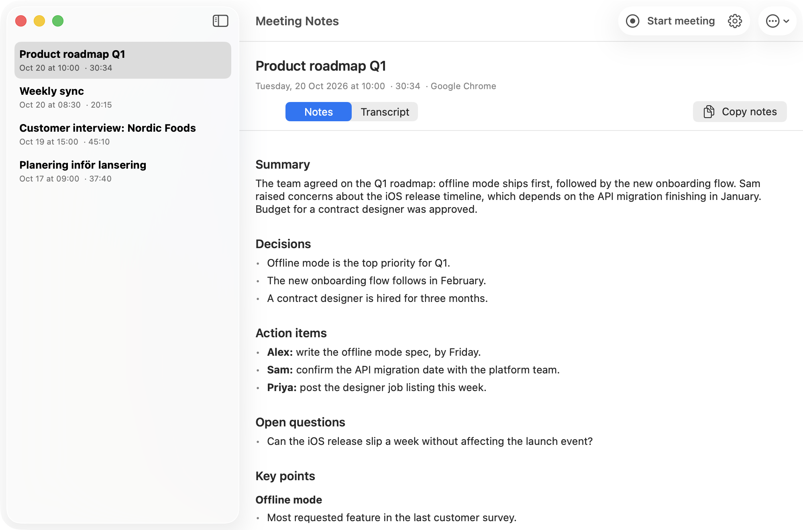
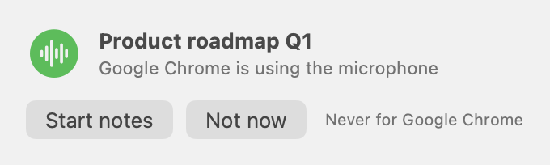

# Meeting Notes

A small native macOS app that records your video calls, transcribes them **on your Mac** with
[whisper.cpp](https://github.com/ggml-org/whisper.cpp), and writes structured meeting notes with
[Claude Code](https://claude.com/claude-code) or [Codex (OpenAI)](https://developers.openai.com/codex/cli/).

- **Two tracks, no virtual audio driver.** Your microphone and the call audio are captured separately with
  a Core Audio tap, so the transcript knows who said what (your name vs "Others").
- **Detects calls automatically.** When an app such as Google Meet (in any browser), Zoom, Teams or FaceTime starts
  using the microphone, a small prompt offers to take notes, and recording stops a few seconds after you leave the call.
- **Names meetings for you.** In browsers it reads the call tab's title (e.g. "Meet – Weekly sync" becomes "Weekly sync").
- **Private by default.** Audio never leaves your Mac. Only the text transcript is sent to your selected provider to write the notes.
- **Runs in the background.** It starts at login without a window, lives in the menu bar, and sends a notification
  when the notes for a meeting are ready.
- **Swedish, Danish and English** (or automatic language detection). Notes are written in the meeting's language.

<p align="center">
  <picture>
    <source media="(prefers-color-scheme: dark)" srcset="docs/images/window-dark.png">
    
  </picture>
</p>
<p align="center">
  <picture>
    <source media="(prefers-color-scheme: dark)" srcset="docs/images/prompt-dark.png">
    
  </picture>
</p>

Each meeting gets its own folder with `transcript.md`, `notes.md` (Summary, Decisions, Action items, Open questions,
Key points), the audio as 16 kHz WAV, and `meta.json`.

## Requirements

- macOS 15 (Sequoia) or newer, Apple silicon or Intel
- Xcode command line tools (`xcode-select --install`)
- [Homebrew](https://brew.sh)
- A Claude account for Claude Code, or a Codex login (ChatGPT or API authentication)
  for OpenAI. The installer installs the selected CLI if missing.
- About 2 GB of disk space for the speech model

## Install

```bash
git clone https://github.com/horken7/MeetingNotes.git
cd MeetingNotes
bash install.sh                       # Claude by default
# or: bash install.sh --provider codex
```

The installer:

1. installs `whisper-cpp` with Homebrew and the selected notes CLI if needed,
2. downloads the Whisper `large-v3-turbo` model (about 1.6 GB) and the Silero voice activity model to `~/.meetnotes/`,
3. compiles the app with `swiftc`, signs it ad hoc and installs it to `/Applications/Meeting Notes.app`,
4. opens it.

On first launch, allow **Microphone**. When the first recording starts, allow **System Audio Recording** (that is how
the app hears the other people on the call; it never records the screen, so Screen Recording isn't needed). The first time a meeting is
detected in a browser, macOS also asks to let Meeting Notes read the browser's tabs, which is used only for the
meeting name.

Log in once in Terminal: `claude` for Claude Code or `codex login` for Codex.
Choose **Settings > Notes > Write notes with** to switch providers, including when regenerating notes.
Install the other CLI before switching (or rerun `bash install.sh --provider claude|codex` with one provider).
For a custom or npm installation, set the executable's absolute path in Settings. Reinstalling without
`--provider` preserves your selected provider.

> Each build is signed ad hoc, so macOS asks for the permissions again after every reinstall, and it refuses
> notification permission. To fix both, sign with a certificate (below).

### Signing with a certificate (optional)

Pass a code-signing identity from your keychain and the installer signs with it instead of ad hoc. The signature
then stays the same across reinstalls, so Microphone and System Audio Recording permissions are kept, and macOS can
allow real notifications (the "Meeting detected" notification with buttons, clickable "Notes ready" alerts).

```bash
security find-identity -p codesigning          # list the identities you have
SIGN_IDENTITY="Apple Development: Your Name (TEAMID)" bash install.sh
```

Ways to get an identity:

- **Free Apple Development certificate** (recommended): sign in with your Apple ID in Xcode > Settings > Accounts,
  then Manage Certificates > + > Apple Development. It is valid for a year; renew it the same way when
  `find-identity` shows `CSSMERR_TP_CERT_EXPIRED`.
- **Self-signed certificate**: Keychain Access > Certificate Assistant > Create a Certificate…, Identity Type
  Self Signed Root, Certificate Type Code Signing, then use its name as `SIGN_IDENTITY`. This keeps permissions
  across reinstalls; whether macOS grants notification permission for it is less certain than with an Apple
  certificate.

After the first signed install, allow the permissions once more (the signature changed from ad hoc), and allow
notifications when asked or under System Settings > Notifications > Meeting Notes.

## Use

- Join a call. A "Meeting detected" prompt appears after a few seconds: **Start notes**, **Not now**, or
  **Never for this app**. You can also press **Start meeting** in the window or the menu bar.
  The prompt is a notification when notifications are allowed (click it or choose Start notes from its Options
  menu; set the app to **Alerts** in System Settings > Notifications to keep it on screen), and otherwise a small
  floating panel. Settings > Automatic > Ask with chooses between them.
- The menu bar icon shows the state: waveform (idle), red dot (recording), hourglass (transcribing / writing notes).
- When the notes are ready you get a notification; click it to open the meeting. macOS refuses notification
  permission for ad hoc signed apps, so in that case the alert is sent through Script Editor instead (allow Script
  Editor under System Settings > Notifications) and calls are offered with the floating panel; see
  [Signing with a certificate](#signing-with-a-certificate-optional). Settings > Setup shows the status and has a **Send test** button.
- Closing the window keeps the app running in the menu bar (no Dock icon). Open it again from the menu bar or
  by opening the app. It starts at login by default; turn that off in Settings.
- Leave the call and recording stops on its own about 5 seconds later. Transcription takes roughly a minute per
  10 minutes of call, then your selected provider writes the notes.
- In the window you can rename meetings, copy notes or the transcript, regenerate notes, redo the transcript,
  show the folder in Finder, or move a meeting to the Trash (right-click or ⌘⌫).

To change how the notes look (sections, length, style, language), edit **Settings > Notes > How the notes should
look**. Your name, who is who and the meeting title are always added; **Reset to default** restores the standard
format, and **Regenerate notes** applies a new format to an existing meeting.

Meetings are saved in `Meetings/` inside this folder (ignored by git). Change the folder, your name, language,
automatic start/stop, open at login and whether audio is kept in **Settings**.

## Ask Claude about your meetings (MCP)

The installer also builds a small, read-only [MCP](https://modelcontextprotocol.io) server at
`~/.meetnotes/bin/meetingnotes-mcp`, so Claude Code, Claude Desktop and other MCP clients can look up your meetings.
It reads `meta.json`, `notes.md` and `transcript.md` in your meetings folder (the one set in Settings), never
audio files, and can't change or delete anything. It runs only when a client starts it, on your Mac.

Claude Code (**Settings > Setup** has a button that copies this command):

```bash
claude mcp add meeting-notes -- ~/.meetnotes/bin/meetingnotes-mcp
```

Add `--scope user` to use it in every folder, not just the current project. Claude Desktop: open
**Settings > Developer > Edit Config** and add the server to `claude_desktop_config.json` (use your full home path),
then restart Claude Desktop:

```json
{
  "mcpServers": {
    "meeting-notes": {
      "command": "/Users/YOU/.meetnotes/bin/meetingnotes-mcp"
    }
  }
}
```

Then ask things like "What did we decide in last week's sync?" or "Find meetings where we talked about the budget".

| Tool | What it does |
|---|---|
| `list_meetings` | Meetings, newest first: id, title, date, duration, status, call app. Optional `from` / `to` (YYYY-MM-DD) and `limit` |
| `search_meetings` | Case-insensitive search across titles, notes and transcripts, with snippets |
| `get_notes` | The notes of a meeting (by id) |
| `get_transcript` | The transcript of a meeting (by id); long ones are returned in 100,000-character parts |

Notes and transcripts of the 100 newest meetings are also listed as MCP resources. Set `MEETINGNOTES_DIR` in the
server's environment to read another folder. Notes and transcripts you look up are sent to the MCP client's model
like any other text you share with it.

## How it works

| File | What it does |
|---|---|
| `src/App.swift` | App entry point, main window and menu bar item |
| `src/Model.swift` | Settings, meeting storage, start/stop, call detection and auto-stop |
| `src/Recorder.swift` | Mic (AVAudioEngine) and system audio (Core Audio process tap) capture into two `.caf` files |
| `src/MicMonitor.swift` | Which apps are using the microphone or playing sound (Core Audio process objects) |
| `src/CallInfo.swift` | Meeting name from the browser's call tab |
| `src/Pipeline.swift` | `afconvert` to 16 kHz WAV, `whisper-cli` transcription, transcript merge, notes via `claude -p` or `codex exec` |
| `src/Views.swift` | SwiftUI views, Markdown rendering, settings, the meeting prompt |
| `mcp/main.swift` | Read-only MCP server (stdio, JSON-RPC) for Claude and other MCP clients |

Claude Code is run with `ANTHROPIC_API_KEY` removed from its environment, so it always uses your Claude
subscription rather than API billing. Codex uses its existing CLI authentication and default model;
API-authenticated Codex usage may incur API charges. It runs non-interactively with a read-only sandbox
in a temporary directory, receives the prompt and transcript through stdin, and returns notes on stdout.
See [Codex non-interactive mode](https://developers.openai.com/codex/noninteractive).

## Development

```bash
bash tests/run.sh     # builds the app and runs the unit tests
bash install.sh       # builds and installs the app
```

The tests are a small runner in `tests/main.swift` (no XCTest needed, so the command line tools are enough). They cover
the transcript merge, noise filtering, meeting folders and metadata, call-app grouping, meeting title parsing and the
provider routing, CLI failures and the Claude environment, plus JSON-RPC round trips through the built MCP server. CI runs the same script on GitHub Actions (`macos-15`).

To refresh the README screenshots (only this needs Screen Recording; macOS asks for it the first time):

```bash
open -a "Meeting Notes" --args -captureScreenshots "$PWD/docs/images" -outputDir /path/to/demo/meetings \
    [-screenshotAppearance dark]
```

`docs/VERIFY.md` is the manual end-to-end checklist (permissions, recording, languages, auto-detection, robustness).

## License

MIT, see [LICENSE](LICENSE).
